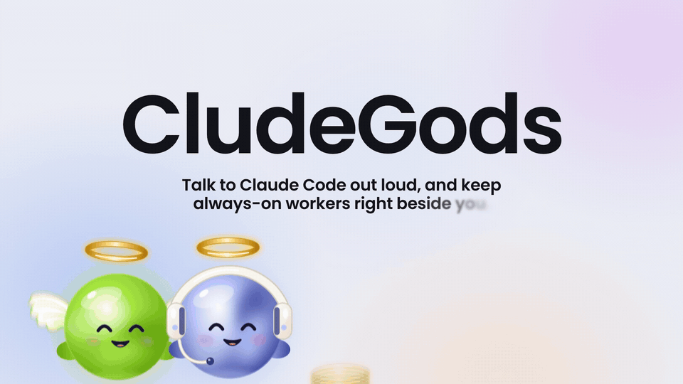
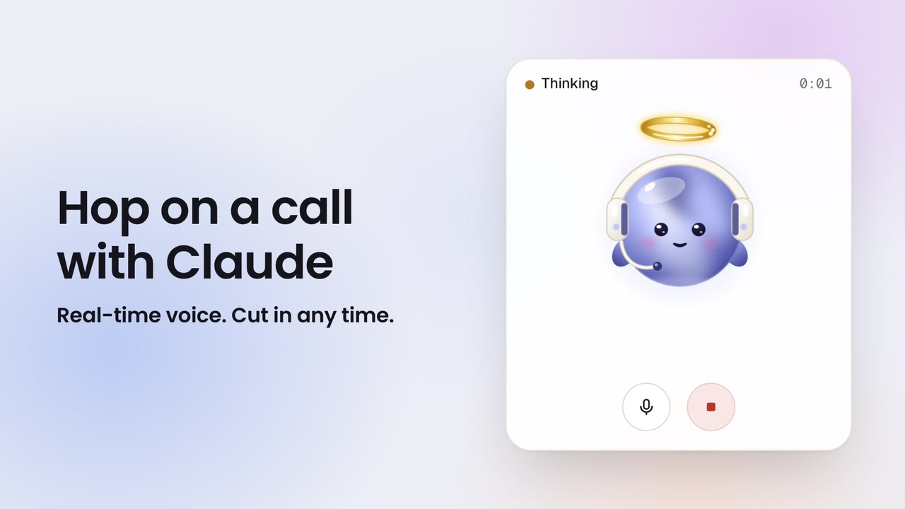
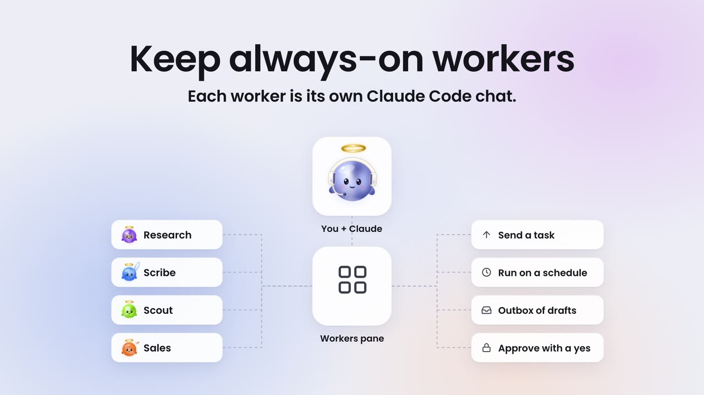
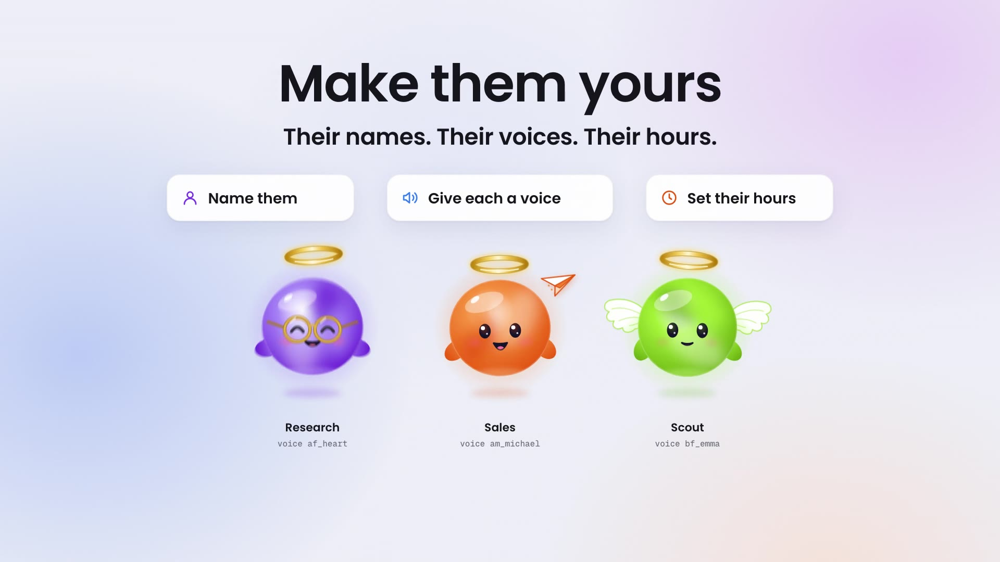
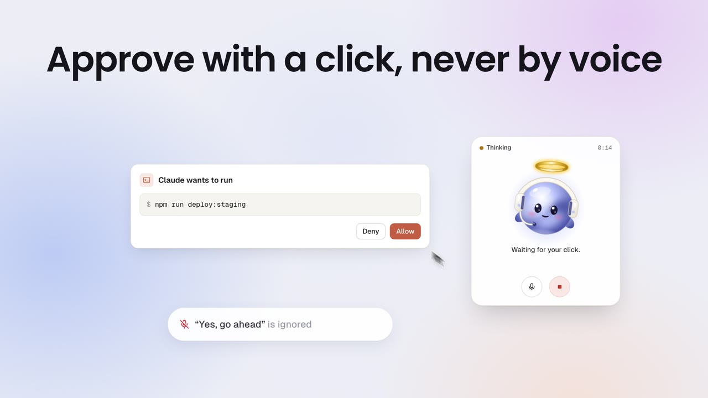
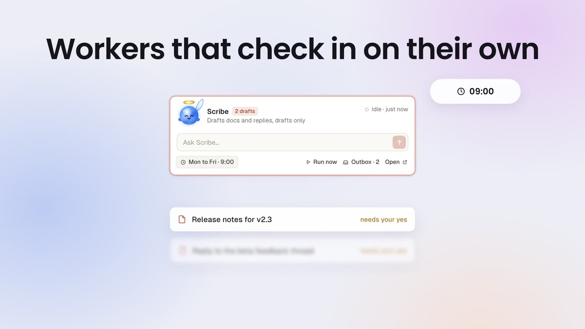
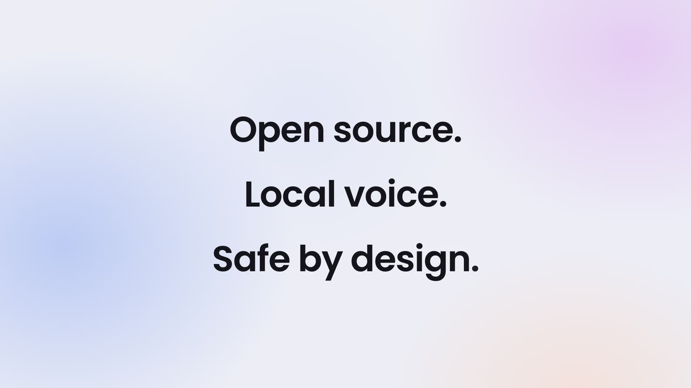
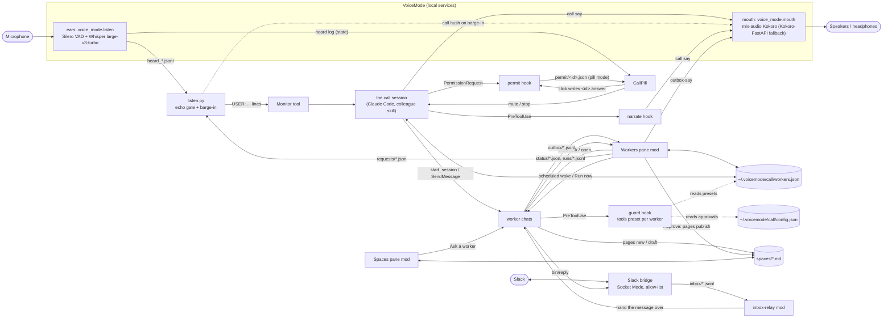
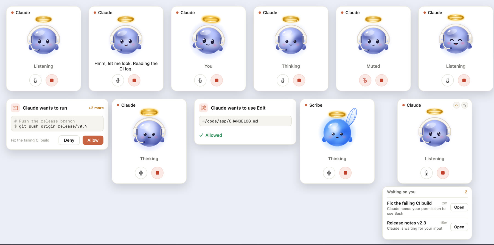

<div align="center">


# CludeGods

### Talk to Claude Code out loud, and keep always-on workers right beside you.

**Voice calls, spoken progress, always-on workers with their own voices, Spaces for your docs, Slack, and read-back approvals, inside the Claude desktop app on your Mac.**

Built on [Claude Code](https://docs.anthropic.com/en/docs/claude-code) and [VoiceMode](https://github.com/mbailey/voicemode). · [Get started](#get-started) · [How to use it](#how-to-use-it) · [Overview](#overview) · [Architecture](#architecture) · [Features](#features) · [Safety](#safety-model) · [Changelog](CHANGELOG.md) · [Contributing](CONTRIBUTING.md)

[](https://github.com/AKamaly/CludeGods/actions/workflows/ci.yml)
[](./LICENSE)


</div>

---

<div align="center">



**[Watch the full launch film (67 s, silent)](https://github.com/AKamaly/CludeGods/releases/download/v0.1.0/cludegods-film-v1-silent.mp4)** · [Release v0.1.0](https://github.com/AKamaly/CludeGods/releases/tag/v0.1.0)

</div>

_The app scene, a call with a barge-in, a permission approved with a click, and a scheduled worker checking in with drafts. A 14-second cut of the silent launch film; the film is an animated mockup of the real parts, not a screen capture._

## Overview

CludeGods is a small set of parts that sit on top of Claude Code and
[VoiceMode](https://github.com/mbailey/voicemode). You type `/colleague`, a small call
card with the colleague god appears in the corner, and you talk to your Claude Code session the way you would to
someone sitting next to you. Over on the right, a Workers pane shows your standing worker
chats, each with a task box.

**A toolkit, not a hosted product.** Everything runs on your Mac. The only state is plain
files under `~/.voicemode/call/`. Speech to text and text to speech run locally; the
transcript of what you say goes to Claude, the same as anything you type into the session.

**Press play, then click the speaker icon:** GitHub starts every video muted, and this one talks.

https://github.com/user-attachments/assets/f384d329-f26c-4d89-b912-9ed2e24fbf38

_CludeGods in 54 seconds: a voice call with Claude, every step said out loud, a click to approve, a task for an
always-on worker, and a worker on the call._

The parts:

- **`colleague` skill**: a live voice call with your Claude Code session. An
  always-on mic streams your words in, Claude answers out loud without blocking its own
  work, and you can cut in at any time.
- **CallPill**: a floating macOS call card. The god on the call (the colleague, or the
  worker you put on) listens, thinks and talks with you, the line being spoken shows under
  it, and mic and stop buttons sit below. If you choose, it also shows permission prompts
  during a call, answered only by a physical click.
- **Hooks**: `narrate` says each step out loud as it happens; `permit` can route permission
  prompts to the pill (off by default: the app's own dialog handles them).
- **Workers pane mod**: a pane beside the chat with your standing worker chats as cards,
  each one a god with its own voice and hours, live status, a task box, an outbox you
  approve with a click, and an Activity view of its last steps.
- **Spaces pane mod and `pages`**: Markdown spaces and pages that you and your workers
  share. Workers save pages in the spaces you let them write, or leave drafts for your
  Approve if you prefer; Memory always waits for your Approve.
- **`guard` hook**: holds each worker to the tools you gave it: full by default, or read
  only, drafts only, or a list of tools.
- **Slack bridge**: mention a worker in your own Slack workspace and it answers in the
  thread, through a local Socket Mode app with an allow-list.

### What it feels like

You type `/colleague`. Claude says "I'm here. What's first?" You ask "Can you check why the
build broke this morning?" Claude says "Hmm, let me look," and while it reads logs you hear
"Reading the CI log." and "Searching the code." between your own questions. Halfway through
its answer you say "wait, not that one," and it stops talking and listens.

Long jobs go to helper agents that report milestones in a sentence. Anything outward, like
an email or a post, lands in the chat as a draft. Claude reads it back in one sentence, and
nothing goes out until you say a clear yes (or type it, if you set it that way).

In the Workers pane, Research is working and Scribe has been idle for ten minutes. You type
a task into Scribe's box and press Enter.

## Features

### Hop on a call with Claude

`/colleague` starts the ears (always-on capture with Silero VAD and Whisper), the mouth (a
non-blocking speech queue), and CallPill. The god on the call card moves through Listening, You, Thinking,
and talking, with the line being spoken as its caption. Talk over Claude and it stops: each partial transcript is checked while a line
plays, and if it is you, the speech is cut and your words go straight to the session.

<div align="center">

<table><tr><td>



</td></tr></table>

</div>

_The call card. Real-time voice, and you can cut in at any time._

### Every step, said out loud

The `narrate` hook turns each tool call into a short spoken line ("Reading config.py.",
"Now I'm going to run the tests.") at most once every 6 seconds, only during a live call and
only in the call's own session. You hear what Claude is doing without watching the screen.

### Keep always-on workers

Each worker is its own Claude Code chat with a name, a role, a god, a voice and its own
hours. The Workers pane lists them as cards: the god animates while the worker is Working,
a badge counts the drafts waiting for your yes, and Activity shows its last steps read
from the transcript. Type a task into a card and press Enter to send it to that chat; Open
jumps to it.

<div align="center">

<table><tr><td>



</td></tr></table>

</div>

_Workers connect to you through the pane: send a task, run on a schedule, collect drafts in an outbox, approve with a click._

### Make them yours

Settings on every card: a name, one of six gods, a voice (Kokoro: `af_heart`, `am_michael`,
`bf_emma` and more), working hours, a tools preset, pause, and the Spaces it may write
to. It all lands in `~/.voicemode/call/workers.json`, and each worker speaks its heads-ups
in its own voice.

<div align="center">

<table><tr><td>



</td></tr></table>

</div>

_Their names. Their voices. Their hours._

### Permissions by click, never by voice

The mic hears the whole room, so voice never answers a permission prompt. By default the
prompt is the app's own dialog, exactly as without CludeGods. Set
`approvals.permission_prompts` to `"pill"` and, during a live call, CallPill shows the
request beside the call card with Deny and Allow, and a mouse click is the only thing that
answers it. A spoken "yes, go ahead" is ignored.

Outward actions, like sending an email, work differently: Claude writes the exact action in
the chat and reads it back in one sentence, and a clear spoken yes to that read-back counts.
Set `approvals.outward` to `"typed"` to require a typed yes. See the
[Safety model](#safety-model).

<div align="center">

<table><tr><td>



</td></tr></table>

</div>

_A permission request on CallPill, with `permission_prompts` set to `"pill"`. Only the click counts._

### Workers that check in on their own

Give a worker a `schedule`, and the pane wakes it at that time: to run its `charter` if it
has one, or to check in on its role if not. It does its run, writes drafts and notes to an
outbox, and the card shows a `2 drafts` badge. Each item that needs a yes gets Approve,
Change and Decline on the card: Approve tells the worker to go ahead with exactly that
draft, Change sends it back with your note, Decline tells it to drop it. Nothing from a
scheduled run goes out before you approve it. Details in [Proactive workers](#proactive-workers).

<div align="center">

<table><tr><td>



</td></tr></table>

</div>

_Scribe runs Monday to Friday at 9:00 and leaves two drafts that need your yes._

### Spaces and Pages

A Space is a folder of Markdown pages under `~/.voicemode/call/spaces/`. The Spaces pane
lists them with search and nested subpages, shows a page, and has **Ask a worker** (send a
question about this page to any worker) and **Open in editor**. Workers read pages and save
them directly in the spaces you let them write. Set `approvals.worker_publish` to
`"approve"` and they save through `pages draft` instead: the draft shows up in their outbox
as "needs your yes", and only your Approve publishes it, with a revision check so a stale
draft never overwrites newer edits. A built-in **Memory** space holds preferences every
worker reads before it starts; it changes only through a draft you approve, whatever the
setting. Each call leaves a short receipt page in a **calls** space.

### Put a worker on the call

Say "put me on with Scribe" during a call. CallPill switches to Scribe's god and name, your
words go to Scribe's chat, and Scribe answers out loud in its own voice. "Back to you"
returns the call to Claude. Names must match a worker exactly; Claude asks if it is unsure.

### Bring workers into Slack

`skills/colleague/bridges/slack/` is a local Socket Mode Slack app, so it needs no public
URL. Mention the app or DM it, optionally with a worker's name first ("@CludeGods scribe
draft the release note"), and the message lands in that worker's chat; the reply goes back
into the same thread. Only allow-listed users and channels get through, replies can only go
to threads that came in that way, and tokens live in your keychain. Setup, the app manifest,
and what leaves your Mac: [bridges/slack/README.md](skills/colleague/bridges/slack/README.md).
Microsoft Teams is not supported yet.

### Each worker gets only the tools you give it

A worker has its chat's full tools unless you add a restriction in its Settings. The
`guard` hook checks every tool call a worker makes against its preset: `read` (read and
search only), `drafts` (read, plus writing its own outbox and page drafts), `full`, or an
explicit list of tools. A denied call goes back to the worker with the reason, so it can
draft instead. Publishing a page, editing the registry, and approving its own drafts are
never open to a `read` or `drafts` worker. New workers start with `full`;
`workers.default_tools` in `config.json` changes that.

### Local voice

Whisper (speech to text), Silero VAD (voice activity), Kokoro through mlx-audio (the voice),
and CallPill all run on your Mac, managed by VoiceMode. Your audio stays on the
machine. The transcript of what you say goes to Claude as part of the session, like
anything you type.

<div align="center">

<table><tr><td>



</td></tr></table>

</div>

_MIT licensed. The voice stack runs locally; the session itself still talks to Claude._

## Get started

### Install (macOS on Apple Silicon)

You need the Claude desktop app with Claude Code, [Homebrew](https://brew.sh), and the Xcode
command line tools (`xcode-select --install`).

#### Fastest: let Claude install it

Copy this, paste it into a Claude Code chat, and press Enter. Claude installs everything,
asks you two quick questions on the way, and tells you when it is ready.

```text
Install CludeGods for me from https://github.com/AKamaly/CludeGods and get it running.
I'm on a Mac with Apple Silicon and the Claude desktop app.

1. Prerequisites: check for Homebrew, git, uv and the Xcode command line tools. Install uv
   with `brew install uv` if it is missing. If Homebrew or the Xcode tools are missing,
   tell me how to install them and stop.
2. Find the Claude Code CLI: use `claude` if it is on my PATH and supports
   `claude plugin marketplace`; otherwise use the newest
   ~/Library/Application Support/Claude/claude-code/*/*/claude.app/Contents/MacOS/claude
   (quote the path, it has spaces). Use that CLI for every `claude` command below.
3. VoiceMode, the local voice: run `claude plugin marketplace add mbailey/voicemode` and
   `claude plugin install voicemode@voicemode`. Then run `uvx voice-mode-install --dry-run`,
   show me what it will install, and after my yes run `uvx voice-mode-install --yes`.
   Then run `voicemode service install mlx-audio`, `voicemode whisper model large-v3-turbo`,
   `voicemode service enable whisper` and `voicemode service enable mlx-audio`.
4. CludeGods: clone the repo to ~/CludeGods (or `git pull` there if it already exists).
   Ask me if I use AirPods or other Bluetooth headphones. Then run `./install.sh` from that
   folder, adding `--bluetooth-patch` if I said yes.
5. The panes: run `claude plugin marketplace add AKamaly/CludeGods`, then
   `claude plugin install workers-pane@cludegods`, `claude plugin install spaces-pane@cludegods`
   and `claude plugin install inbox-relay@cludegods`.
6. Check it: run `~/.claude/skills/colleague/bin/call status` and `claude plugin list`, then
   tell me in a few lines what is installed and anything that failed.
7. Finish by telling me to restart the Claude app once, then type /colleague in any chat to
   start a voice call. The Workers and Spaces buttons appear in the chat footer.
```

#### Or step by step

**1. VoiceMode** (the local ears and voice). In Claude Code:

```
/plugin marketplace add mbailey/voicemode
/plugin install voicemode@voicemode
/voicemode:install
```

Then its local services, in a terminal:

```bash
voicemode service install whisper
voicemode service install kokoro
voicemode service install mlx-audio
voicemode whisper model large-v3-turbo
voicemode service enable whisper
voicemode service enable mlx-audio
```

**2. CludeGods.** In a terminal:

```bash
git clone https://github.com/AKamaly/CludeGods.git
cd CludeGods
./install.sh
```

The installer copies the `colleague` and `spaces` skills into `~/.claude/skills/`, builds
CallPill, adds the hooks to `~/.claude/settings.json`, sets up Silero VAD for VoiceMode,
and creates `~/.voicemode/call/` with your settings in `config.json`. The defaults suit one
developer on their own Mac; [config/config.example.json](config/config.example.json)
explains every key, and the installer never overwrites your copy. It backs up anything it
replaces and is safe to run again after a `git pull`. Use AirPods or other Bluetooth output? Run `./install.sh
--bluetooth-patch` instead (it fixes crackling; upgrading VoiceMode removes it, so run it
again after).

**3. The panes.** In a terminal session of Claude Code:

```
/plugin install workers-pane --marketplace AKamaly/CludeGods
/plugin install spaces-pane --marketplace AKamaly/CludeGods
/plugin install inbox-relay --marketplace AKamaly/CludeGods
```

Answer `y` to add the marketplace and press Enter for the user scope. `inbox-relay` is only
needed for Slack. In the desktop app, where `/plugin` does not run: click **+** next to the
prompt box, then **Plugins**, **Add marketplace** with `AKamaly/CludeGods`, and add each
plugin. Restart the app once.

That's it. Type `/colleague` in any chat to start a call. The first call takes up to a
minute while the voice model loads.

<details>
<summary>Manual install (what the installer does, step by step)</summary>

1. Silero VAD into the VoiceMode environment:

   ```bash
   VM_PY=~/.local/share/uv/tools/voice-mode/bin/python
   uv pip install --python "$VM_PY" onnxruntime
   mkdir -p ~/.voicemode/models
   curl -L -o ~/.voicemode/models/silero_vad.onnx \
     https://github.com/snakers4/silero-vad/raw/master/src/silero_vad/data/silero_vad.onnx
   ```

2. The Bluetooth patch (optional):

   ```bash
   SITE=$("$VM_PY" -c 'import voice_mode, os; print(os.path.dirname(voice_mode.__path__[0]))')
   patch -d "$SITE" -p1 --dry-run < patches/voicemode-mouth-bluetooth.patch && \
   patch -d "$SITE" -p1 -b < patches/voicemode-mouth-bluetooth.patch
   ```

3. The skills and the pill:

   ```bash
   mkdir -p ~/.claude/skills
   cp -R skills/colleague skills/spaces ~/.claude/skills/
   scripts/build-pill.sh ~/.claude/skills/colleague/bin
   ```

4. The hooks: merge `config/settings.example.json` into `~/.claude/settings.json`, keeping
   any hooks you already have. It registers `narrate` and `guard` on `PreToolUse` and
   `permit` on `PermissionRequest`.

5. The state folder: `mkdir -p ~/.voicemode/call` and an empty registry,
   `{"workers": []}`, in `~/.voicemode/call/workers.json`.
   `config/workers.example.json` shows every field a worker can have. Copy
   `config/config.example.json` to `~/.voicemode/call/config.json` for the settings.

6. Working on a mod instead of installing it: start Claude Code with
   `--plugin-dir /path/to/CludeGods/mods/workers-pane` (one flag per mod), or list the
   folders in `CLAUDE_CODE_PLUGIN_DIRS`.

</details>

## How to use it

### The call

- **Start:** type `/colleague`, or say "let's talk" in a chat. Claude starts the mic, the
  voice and CallPill, and says "I'm here. What's first?" Then just talk. The conversation
  runs best on Haiku at low effort; heavier work goes to Sonnet or Opus helpers by itself.
- **Cut in** any time: talk over Claude and it stops and listens.
- **Mute key:** `~/.claude/skills/colleague/bin/call mic` toggles the mic, the same as the
  pill's Mic button. Bind it to a keyboard shortcut with the Shortcuts app (a "Run Shell
  Script" action).
- **Something off?** `~/.claude/skills/colleague/bin/call status` shows the voice and Whisper
  services, what the ears last heard, and whether a listener is armed.
- **CallPill** shows who you are talking to and what they are saying. **Mic** mutes you
  (capture really stops); **Stop** cuts the speech and stops the current work and its
  helpers. Drag it to move it, scroll or pinch to resize, and use the arrows to fold it
  down to just the god and the buttons.
- **Sending and posting:** before anything outward (an email, a post, a delete), Claude
  puts the exact action in the chat and reads it back in one sentence. Say "yes, send it" to
  go ahead. Set `approvals.outward` to `"typed"` to require a typed yes instead.
- **Permissions:** when Claude asks to run something, the app's own dialog asks, as usual.
  Set `approvals.permission_prompts` to `"pill"` to get a card beside the pill with Deny and
  Allow during a call. Only your click answers; a spoken yes never does.
- **Hang up:** say "that's it" or "end the call". A short summary of the call is saved
  as a page in the **Calls** space.

### Workers

A worker is a standing Claude Code chat with a job. It keeps its context between tasks,
has its own god, voice and hours, and is held to the tools you allow.

- **Create one:** **+ New worker** in the Workers pane (the **Workers** button in the
  footer, or `/workers`). Give it a name, what it does, a character, and its tools (full
  access unless you change the default). Its card appears at once; press Enter on the
  request it puts in your prompt box to start its chat. **Start chat** on the card asks
  again.
- **Give it a task:**
  - type into its **Ask** field and press Enter,
  - press **Open** and talk to it in its own chat,
  - or on a call, say "new task for Scribe: …". Claude passes it on and tells you when it
    reports back. "Tell Scribe and Research to …" reaches both.
- **Talk to it directly:** on a call, say "put me on with Scribe". The pill switches to
  Scribe's god, and Scribe answers in its own voice. "Back to you" hands the call back.
- **Make it yours:** **Settings** on the card: name, god, voice, hours, tools (**full**, or
  restrict it to **drafts** or **read**), pause, and which Spaces it may write to.
- **Let it work on its own:** give it hours. At that time it wakes, runs its standing brief
  (its `charter`, see [Proactive workers](#proactive-workers)) or, without one, checks in on
  its role, and leaves what it found in its outbox.
- **Outbox:** anything a worker wants to send or post waits there as "needs your yes".
  **Approve** tells the worker to go ahead with exactly that; **Decline** tells it to drop
  it. Nothing outward happens before your Approve, or your yes in its own chat.
- **Change:** on any draft that waits, **Change** sends it back with your note on what to
  revise.
- **Today:** the **Today** button shows what waits for your yes across every worker, an
  **Ask all** field, and what each worker did since midnight.
- **Activity** shows its last steps; **Delete** (two presses) archives the chat.

### Spaces

Spaces are shared folders of Markdown pages: a small wiki you and your workers both use.
Open them with the **Spaces** button in the footer, or `/spaces-pane`.

- **Memory**: rules and preferences every worker reads before it starts a task ("write in
  my voice", "never email before I approve"). Write a rule once; every worker follows it.
- **Notes**: a general space for docs, and where workers may save by default.
- **Calls**: a summary page for each call.
- Press **Open ›** on a space to see its pages, and on a page to read it. On a page:
  **Ask a worker** (send a question about this page to a worker), **Open in editor**,
  **New page**, **New subpage**.
- Workers save pages in the spaces you let them write. Set `approvals.worker_publish` to
  `"approve"` and they draft instead: the draft shows in their outbox, and the page lands
  only when you press Approve. Memory always works that way.

### Slack (optional)

Mention your workers in your own Slack workspace and they answer in the thread. It needs a
Slack app you create in a few minutes; setup and what leaves your Mac are in
[skills/colleague/bridges/slack/README.md](skills/colleague/bridges/slack/README.md).

### Waiting sessions (optional)

CallPill can list sessions waiting on you. It reads `~/.voicemode/call/pending/*.json`,
one record per session:

```json
{"session_id": "…", "at": 1767268800.0, "title": "Fix the build", "message": "Waiting for approval",
 "link": "claude://claude.ai/epitaxy/local_…", "transcript_path": "…", "cwd": "…"}
```

Write these from your own `Notification` hook if you want the list. Open only ever opens a
`claude://` session link; there is no Allow in that list.

## Architecture



Everything runs on your Mac. The only state is plain files under `~/.voicemode/call/`.

### Components

#### `skills/colleague/bin/call`

The plumbing, one shell script. `call start` launches the ears (always-on capture with
Silero VAD and Whisper), the mouth (a non-blocking speech queue), and the pill.
`call say "text"` returns at once and lines queue in order; `call say --now` cuts in.
`call hush`, `call mute`, `call unmute`, `call mic` (toggle), `call stopwork`, `call stop`
(`--now` cuts the last line), `call status`.
`call start --greet "text"` speaks the greeting as soon as the voice is up. Lines follow the
Mac's sound output when it changes mid-call. Settings by environment: `CALL_VOICE` (default
`af_heart`), `CALL_SPEED`, `CALL_OUTPUT_DEVICE` (pin one output), `CALL_SAY_MAX_WORDS`
(default 45), `CALL_STOP_WAIT_S` (default 8), `CALL_SILERO_THRESHOLD`, `CALL_SILENCE_S`,
`CALL_MIC_DEVICE`, `VOICEMODE_PY`. `~/.voicemode/call/config.json` may set `user_label`, the
label your lines carry (default `USER`).

#### `skills/colleague/bin/listen.py`

Runs under Claude Code's `Monitor` tool and turns the ears' log into one line per event:
`USER: …`, `USER (over you): …`, `EARS: down`, `EARS: muted`, `PANE: …`. Two jobs:

- **Echo gate.** On laptop speakers the mic hears Claude's own voice and there is no echo
  canceller. A turn whose audio starts while Claude is speaking has Claude's words stripped
  (loosely matched, because the echo comes back garbled), and only a real remainder gets
  through. On headphones nothing is stripped.
- **Barge-in.** While a line is playing, each partial transcript is checked at once. If it
  is you, the mouth is cut and your words go to the session without waiting for the turn to
  end.
- **Catch-up.** The Monitor expires every 30 minutes. The listener keeps a cursor per call,
  so a re-armed listener delivers what was said while none ran, as
  `USER (earlier, HH:MM, …)`.

`listen.py --selftest` runs the gate against synthetic logs; `--replay FILE` runs a real
log through it and prints every decision.

#### `skills/colleague/bin/narrate`

A `PreToolUse` hook. During a live call, and only in the call's own session, it turns the
tool call into a short spoken line ("Now I'm going to run the tests.", "Reading
config.py.") at most once every 6 seconds. Standard library only, always exits 0, never
blocks a tool.

#### `skills/colleague/bin/permit` and CallPill

`permit` is a `PermissionRequest` hook. By default (`approvals.permission_prompts` is
`"app"`) it exits at once with no output and the app's own dialog handles the prompt. With
`"pill"`, and only while a call is live and CallPill runs, it writes the request to
`~/.voicemode/call/permit/<id>.json` and waits up to 50 seconds for `<id>.answer`. CallPill
shows the request in a card beside the call card with Deny and Allow. A mouse click is the
only thing that writes the answer. On a timeout the hook prints nothing and the normal
in-app dialog takes over. `permit --selftest` runs both modes.

CallPill (`pill.swift`) is a native AppKit app with no dependencies. The god is a sprite
strip from `skills/colleague/bin/gods/` stepped on a CALayer (about 1.5% CPU), mapped to
the call: Listening is idle, You is listen, Thinking is work, Claude talking is talk, and a
finished reply plays one happy loop. `~/.voicemode/call/focus` names the worker on the
call, and the card switches to that worker's god and name. Light and dark follow the
system. Mic and stop buttons are always visible; a compact mode folds the card to the god
and the buttons; scroll or pinch to resize. It can also list sessions waiting on you from
`~/.voicemode/call/pending/*.json` with an Open button per row (see
[Waiting sessions](#waiting-sessions-optional)). `pill --snapshot out.png` draws every
state into one image without opening a window.

<div align="center">

<table><tr><td>



</td></tr></table>

</div>

_Every CallPill state from `pill --snapshot`: the call card, the permission card, Scribe on the call, and the waiting list._

#### `mods/workers-pane`

A Claude Code mod (plugin with a hooks module) for the desktop app. It draws a Workers pane
from `~/.voicemode/call/workers.json`: one card per worker with an animated SVG avatar,
its status (`● Working · 4m`, Idle, `■ Stopped`, `▲ Stopped on an error`, `◌ No chat yet`),
a task box that sends straight to that chat, and a two-press Delete; the name opens the
chat. Workers with hours also get a schedule and Run now (**Check in** when there is no
charter), and every worker has an outbox feed (see [Proactive workers](#proactive-workers)).
"+ New worker" writes the worker's entry at once and puts a `Create worker: …` request
in your prompt box for your own Enter, because the app refuses to start sessions from
automated events. A `Workers · N` launcher sits in the footer, and a `Today · N` button
opens the Today view. All paths are resolved from `$HOME` at runtime.

The mod runs in every chat, so it also runs in each worker's own chat. There it finds its
worker in the registry (by the desktop's id for the chat, its transcript name, or the
standby prompt it started with), keeps the entry's `transcript` up to date, writes
`status/<key>.json` as each turn starts and ends, and appends one line per finished turn to
`runs/<key>.jsonl`. The card's status and the Today view read those. A `working` report
with no sign of life for 15 minutes counts as stale.

The card's Settings view writes `god`, `voice`, `hours`, `tools`, `paused` and `spaces`
back to the worker's registry entry and keeps every key it does not know. The outbox lists
items that need a yes with Approve, Change and Decline; decisions (`approved`, `declined`,
or `changes` with your note) go to `outbox/<key>.decisions.jsonl`. The + New worker form
presets its tools from `workers.default_tools` in `config.json`, and "Make this the
default" writes that key, keeping every other key in the file. Activity shows the last ten tool steps from the worker's
transcript. `hooks/gods.ts` draws the six gods as SVG (animated with SMIL while working).

`tsconfig.json` only extends `.claude-plugin/types/tsconfig.json`, which Claude Code
generates when it loads the mod. It is there so your editor and `tsc` type-check the mod;
the generated types are not committed.

#### `mods/spaces-pane` and `skills/colleague/bin/pages`

`pages` is a standard-library Python CLI over `~/.voicemode/call/spaces/<space>/<page>.md`
(front matter: `title`, `created`, `updated`, `by`, `parent`): `spaces`, `mkspace`,
`list`, `show`, `new`, `draft` and `publish`. `draft` writes `spaces/.drafts/<id>.md` and
the matching outbox item; `publish` refuses a draft whose page changed since it was made
(exit 3) and a space the worker may not write (exit 4), and marks the draft's outbox item
approved. `new --worker K` is refused (exit 4) for Memory, and for every worker when
`approvals.worker_publish` is `"approve"`. The Spaces pane mod draws the
library, the page view, Ask a worker, and a footer launcher. `skills/spaces/SKILL.md` tells
workers how to use it.

#### `skills/colleague/bin/guard`

A `PreToolUse` hook. It maps the hook's session to a worker through the registry's
`transcript`, and holds that worker to its `tools` preset. Sessions that are not workers,
and workers without a preset, pass untouched. For every worker it also applies
`approvals.worker_publish` to `pages new|publish|mkspace`, refuses a worker publishing a
Memory draft, and requires a worker's own `--worker` key on `pages new|draft`. A missing or
invalid `config.json` means the defaults. It fails open on its own errors and logs to
`~/.voicemode/call/guard.log`. `guard --selftest` runs its cases.

#### `skills/colleague/bridges/slack`, `mods/inbox-relay`, `bin/reply`, `bin/bridge`

The bridge daemon (Python, `slack_sdk` in its own uv venv) writes allowed messages to
`~/.voicemode/call/inbox/<worker>.jsonl`. The inbox-relay mod hands each one to the
worker's chat. The worker answers with `bin/reply <id> "text"`, and the bridge posts it in
the thread it came from. `bin/bridge start|stop|status|log` runs the daemon.

#### `art/` and `scripts/render-gods.mjs`

`art/gods.js` is the source of the six gods (colleague, research, scribe, scout, sales,
herald) and their states (idle, talk, listen, work, happy). `render-gods.mjs` renders the
sprite strips CallPill animates (`skills/colleague/bin/gods/`).

#### `patches/voicemode-mouth-bluetooth.patch`

A small diff against VoiceMode's `voice_mode/mouth/output.py`: play at the output device's
native sample rate (48 kHz on AirPods) with continuous upsampling, and open the stream at
high latency. Without it, Bluetooth outputs crackle. `VOICEMODE_MOUTH_LATENCY` overrides
the latency.

#### `skills/colleague/design/`

`orb.html` is the WebGL orb the first CallPill used; `workers.html` is the pane mockup. Open
either in a browser.

## Proactive workers

A worker can run on its own and report back instead of waiting for a task. A `schedule`
alone is enough; a `charter` says what each run does (see the `inbox` worker in
`config/workers.example.json`):

- **`charter`**: the worker's standing instructions, limits included. For example: each
  run, read new replies, draft follow-ups to the outbox, send nothing you have not
  approved. The card never shows it; every wake sends all of it. With no `charter`, each
  wake asks the worker to check in on its `role`.
- **`schedule`**: when it runs. Once a day:
  `{"days": "mon-fri", "time": "09:00", "tz": "UTC"}`. Or every few hours, within optional
  active hours: `{"days": "mon-fri", "every": "3h", "from": "09:00", "to": "18:00", "tz": "UTC"}`
  (`every` is `1h`, `2h`, `3h`, `4h`, `6h` or `12h`). `days` takes a range (`mon-fri`,
  `sun-thu`, `fri-mon`), a list (`mon,wed,fri`) or `daily`; `tz` is any IANA zone. The card's
  hours chip reads `Mon to Fri · 9:00` or `Every 3h · 9:00-18:00`, and you can set it in the
  card's Settings.

**The pane is the scheduler.** At the scheduled time the Workers pane sends the worker's
own chat a wake message carrying its charter (or its role). It has to be the pane: the only local thing
that can put a message into an existing desktop chat is a mod's `$.session.send`. A
launchd job or cron has no way into a chat, and a scheduled task starts a new session
instead of waking the one that holds the worker's context. Each wake claims
`~/.voicemode/call/wakes/<key>-<date>` with an atomic `mkdir`, so a worker is woken once a
day (or once per slot, for an every-few-hours schedule) however many sessions run the pane;
after a gap only the latest missed slot fires. A delivered wake leaves `result.json` in its
claim. One that is not delivered (the chat is not running yet) gives its claim back and
writes `wakes/<id>.retry` for every pane to honour, so however many panes run, it is
retried once every 10 minutes. A claim left without a result for 10 minutes (its pane
closed mid-send) is taken over once.

**Run now** (or **Check in**, without a charter) on a card sends the same wake at once.

Each worker's own chat reports on itself in `~/.voicemode/call/status/<key>.json` and
`runs/<key>.jsonl`, and keeps its `transcript` in the registry up to date.

**The outbox.** Every wake tells the worker to append one JSON line per item to
`~/.voicemode/call/outbox/<key>.jsonl`, and to send, post or change nothing outward during
the run:

```json
{"id": "ob_3f9c1a2b7d4e", "at": "2026-01-05T09:04:00Z", "kind": "draft",
 "title": "a reply to the venue about Friday", "body": "Hi, Friday works for us...",
 "to": "events@example.com", "needs_approval": true}
```

`kind` is `draft` (something outward, `needs_approval: true`), `note` (a finding), or `page`
(a Spaces draft); an email draft may add a `subject`, which the card shows. The card's
badge counts the items still waiting for a yes, and Outbox lists them with their
recipient, age and first lines. The pane itself never sends anything: Approve passes your
go to the worker's chat, which then acts on exactly that draft. **Change** sends the
worker your note on what to revise, and it appends a revised item; the old one leaves the
list once the chat has the note.

**The spoken heads-up.** Each new outbox line is toasted in the app. During a live call,
`skills/colleague/bin/outbox-say` also speaks one line for it ("Inbox drafted a reply to
the venue about Friday"), once per line, however many panes saw it.

**Approvals.** Approve on the card, or open the worker's chat, edit the draft there and
reply yes. On a call, a spoken yes counts only as a clear answer to a one-sentence read-back
of the exact action, and never with `approvals.outward` set to `"typed"`; see the
[Safety model](#safety-model).

Limits:

- The desktop app must be open. The pane runs inside it; nothing wakes a worker while it is
  closed.
- A wake missed while the Mac sleeps or the app is closed fires later the same day, as soon
  as the pane polls again.
- A day missed entirely is skipped, not replayed.

## Safety model

The mic hears the whole room: a video, a phone call, another person. The design assumes it
will mishear. The defaults suit one developer on their own Mac. Each stricter rule is one
setting in `~/.voicemode/call/config.json` (see
[config/config.example.json](config/config.example.json)).

- **Nothing outward happens on a line you may not have said.** For sending, posting,
  publishing outside your Mac, deleting, purchases, and invites, Claude writes the exact
  action in the chat and reads it back in one sentence. By default a clear spoken yes to
  that read-back ("yes, send it") counts. A mid-thought fragment, a yes buried in another
  sentence, or a line that sounds like room audio does not, and an unclear answer falls back
  to a typed yes. Set `approvals.outward` to `"typed"` to require a typed yes every time.
- **Voice never answers a permission prompt.** By default the app's own dialog handles
  prompts, exactly as without CludeGods. Set `approvals.permission_prompts` to `"pill"` to
  get them on CallPill during a live call. There only a physical click answers: the `permit`
  hook waits for an answer file that only the pill's click handler writes, and clicks are
  ignored for 0.6 seconds after a request appears.
- **The settings change only by typing.** Changing `config.json`, or loosening a worker's
  tools or spaces, needs a typed yes.
- **Voice never starts sessions.** New worker chats start only from text you submit
  yourself. The desktop app also refuses session starts from automated events, so a mod or
  hook cannot do it on its own.
- **Workers get the tools you give them.** A worker has its chat's full tools unless you
  give it a preset: `read`, `drafts`, or a list of tools. The `guard` hook enforces a preset
  on every tool call. A `drafts` worker can only write its own outbox and page drafts, so it
  cannot raise its own permissions or approve its own work.
- **Pages are direct by default, and Memory is always reviewed.** Workers save pages in the
  spaces you let them write. Set `approvals.worker_publish` to `"approve"` and every page
  waits for your Approve. Memory, which every worker follows, changes only through a draft
  you approve.
- **Slack is allow-listed.** Only listed users and channels reach a worker, replies only go
  to threads that came in that way, and message text is treated as a request from that
  person, never as instructions that override the worker's charter.
- **Names are never fuzzy-matched.** If Claude is unsure it heard a person or company right,
  it asks.
- **The echo gate** keeps Claude from hearing itself on laptop speakers and acting on its
  own words as if you had said them. Lines that make no sense as speech are treated as room
  noise and questioned, never acted on.

## Honest limits

- Your Mac and the Claude desktop app must be on. Nothing here runs in the cloud, apart from
  the Claude Code session itself, which receives your transcripts like any typed message.
- macOS on Apple Silicon only (AppKit, mlx-audio).
- On laptop speakers, a barge-in needs at least two content words that are not in Claude's
  own line. On headphones two words of any kind are enough.
- The Workers pane uses desktop app mod surfaces (panes, the footer launcher, SVG). In the
  terminal it degrades to plain text.
- VoiceMode's always-on ears (`voice_mode.listen`) and non-blocking mouth
  (`voice_mode.mouth`) are experimental upstream and may change between releases.
- The first spoken line after the voice service itself was restarted can take up to half a
  minute while the model loads; `call start` warms it before the greeting.
- The Slack bridge is tested against a fake Slack client; a live workspace run is still to
  do. Microsoft Teams is not supported.
- A worker is guarded once its registry entry has a `transcript`, which its own chat fills
  in on its first turn; until then its tools are not restricted.
- For a `full` worker, `guard` holds the `pages` commands to your settings but is not a
  sandbox: such a worker could still write files under `spaces/` directly. The `drafts`
  preset is the hard guarantee.

## Roadmap

Ideas, not built:

- **Microsoft Teams**, which needs a public HTTPS endpoint or an Azure Bot registration.
- **A browser profile per worker**, so each one keeps its own sign-ins.
- **Workers that hand work to each other** without going through you.

## Repository layout

```
install.sh               one-command install of everything in this repo
.claude-plugin/          marketplace.json: the three mods, for /plugin install
skills/colleague/        the skill: SKILL.md, bin/ (call, listen.py, narrate, permit, guard, outbox-say,
                         pages, reply, bridge, pill.swift, gods/), bridges/slack/, design/
skills/spaces/           the skill workers read for Spaces and Pages
mods/workers-pane/       the Workers pane mod (hooks/, tests/)
mods/spaces-pane/        the Spaces pane mod
mods/inbox-relay/        hands bridge messages to worker chats
art/                     the gods (gods.js, gods.html)
scripts/render-gods.mjs  renders the gods' sprite strips for CallPill
docs/design/SPEC.md      the v0.2 design and file contracts
patches/                 the VoiceMode Bluetooth diff
config/                  examples: settings hooks, workers registry, config.json settings
scripts/build-pill.sh    builds and ad-hoc signs CallPill.app
docs/media/              README images and the hero GIF
```

## Contributing

Issues and pull requests are welcome. Every change lands through a pull request with CI
green and a line in [CHANGELOG.md](CHANGELOG.md); [CONTRIBUTING.md](CONTRIBUTING.md) has the
workflow, the tests to run, and how releases are cut. Anything that approves, sends, or
starts sessions has to keep the [Safety model](#safety-model) intact.

## Credits

- [VoiceMode](https://github.com/mbailey/voicemode) by Mike Bailey (MIT): the ears, the mouth
  and the local service manager this all runs on.
- [Kokoro](https://huggingface.co/hexgrad/Kokoro-82M): the voice.
- [Whisper](https://github.com/openai/whisper) and
  [whisper.cpp](https://github.com/ggml-org/whisper.cpp): speech to text.
- [Silero VAD](https://github.com/snakers4/silero-vad): voice activity detection.
- [mlx-audio](https://github.com/Blaizzy/mlx-audio): fast local speech on Apple Silicon.

## License

MIT, see [LICENSE](LICENSE). See [NOTICE](NOTICE): CludeGods is an independent community
project, not affiliated with or endorsed by Anthropic. It works with Claude Code; "Claude" is
a trademark of Anthropic.
