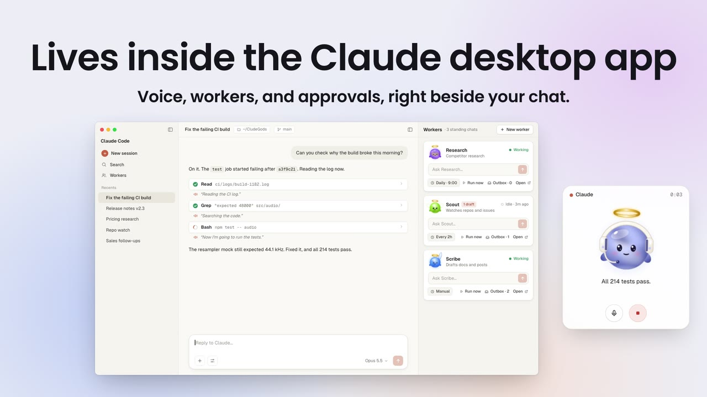
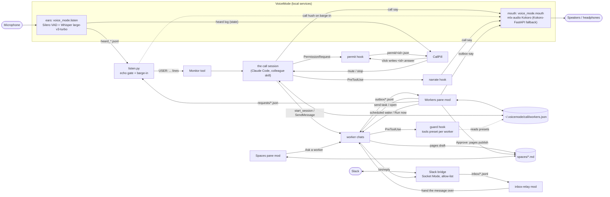

<div align="center">


# CludeGods

### Talk to Claude Code out loud, and keep always-on workers right beside you.

**Voice calls, spoken progress, always-on workers with their own voices, Spaces for your docs, Slack, and click-only approvals, inside the Claude desktop app on your Mac.**

Built on [Claude Code](https://docs.anthropic.com/en/docs/claude-code) and [VoiceMode](https://github.com/mbailey/voicemode). · [Get started](#get-started) · [Overview](#overview) · [Architecture](#architecture) · [Features](#features) · [Safety](#safety-model) · [Contributing](#contributing)

[](./LICENSE)


</div>

---

<div align="center">


**[Watch the full launch film (67 s, silent)](https://github.com/AKamaly/CludeGods/releases/download/v0.1.0/cludegods-film-v1-silent.mp4)** · [Release v0.1.0](https://github.com/AKamaly/CludeGods/releases/tag/v0.1.0)

</div>

_The app scene, a call with a barge-in, a permission approved with a click, and a scheduled worker checking in with drafts. A 14-second cut of the silent launch film; the film is an animated mockup of the real parts, not a screen capture._

## Overview

CludeGods is a small set of parts that sit on top of Claude Code and
[VoiceMode](https://github.com/mbailey/voicemode). You type `/colleague`, a small orb
appears in the corner, and you talk to your Claude Code session the way you would to
someone sitting next to you. Over on the right, a Workers pane shows your standing worker
chats, each with a task box.

**A toolkit, not a hosted product.** Everything runs on your Mac. The only state is plain
files under `~/.voicemode/call/`. Speech to text and text to speech run locally; the
transcript of what you say goes to Claude, the same as anything you type into the session.

<div align="center">

<table><tr><td>



</td></tr></table>

</div>

_The chat, the Workers pane, and the call card, side by side in the Claude desktop app._

The parts:

- **`colleague` skill**: a live voice call with your Claude Code session. An
  always-on mic streams your words in, Claude answers out loud without blocking its own
  work, and you can cut in at any time.
- **CallPill**: a floating macOS status card with a live voice orb, mute and stop
  controls, and the only place outside the app where a permission prompt can be approved,
  by a physical click.
- **Hooks**: `narrate` says each step out loud as it happens; `permit` routes permission
  prompts to the pill.
- **Workers pane mod**: a pane beside the chat with your standing worker chats as cards,
  each one a god with its own voice and hours, live status, a task box, an outbox you
  approve with a click, and an Activity view of its last steps.
- **Spaces pane mod and `pages`**: Markdown spaces and pages that you and your workers
  share. Workers save drafts; a page lands only after you approve it.
- **`guard` hook**: holds each worker to the tools you gave it (read only, drafts only, or
  full).
- **Slack bridge**: mention a worker in your own Slack workspace and it answers in the
  thread, through a local Socket Mode app with an allow-list.

### What it feels like

You type `/colleague`. Claude says "I'm here. What's first?" You ask "Can you check why the
build broke this morning?" Claude says "Hmm, let me look," and while it reads logs you hear
"Reading the CI log." and "Searching the code." between your own questions. Halfway through
its answer you say "wait, not that one," and it stops talking and listens.

Long jobs go to helper agents that report milestones in a sentence. Anything outward, like
an email or a post, lands in the chat as a draft, and nothing goes out until you type yes.

In the Workers pane, Research is working and Scribe has been idle for ten minutes. You type
a task into Scribe's box and press Enter.

## Features

### Hop on a call with Claude

`/colleague` starts the ears (always-on capture with Silero VAD and Whisper), the mouth (a
non-blocking speech queue), and CallPill. The orb moves through Listening, You, Thinking,
and Claude. Talk over Claude and it stops: each partial transcript is checked while a line
plays, and if it is you, the speech is cut and your words go straight to the session.

<div align="center">

<table><tr><td>


</td></tr></table>

</div>

_The call card. Real-time voice, and you can cut in at any time._

### Every step, said out loud

The `narrate` hook turns each tool call into a short spoken line ("Reading config.py.",
"Now I'm going to run the tests.") at most once every 6 seconds, only during a live call and
only in the call's own session. You hear what Claude is doing without watching the screen.

### Keep always-on workers

Each worker is its own Claude Code chat with a name, a role, a god, a voice and its own
hours. The Workers pane lists them as cards: the god animates while the worker is Working,
a badge counts the drafts waiting for your yes, and Activity shows its last steps read
from the transcript. Type a task into a card and press Enter to send it to that chat; Open
jumps to it.

<div align="center">

<table><tr><td>


</td></tr></table>

</div>

_Workers connect to you through the pane: send a task, run on a schedule, collect drafts in an outbox, approve with a click._

### Make them yours

Settings on every card: a name, one of six gods, a voice (Kokoro: `af_heart`, `am_michael`,
`bf_emma` and more), working hours, a tools preset, pause, and the Spaces it may write
to. It all lands in `~/.voicemode/call/workers.json`, and each worker speaks its heads-ups
in its own voice.

<div align="center">

<table><tr><td>


</td></tr></table>

</div>

_Their names. Their voices. Their hours._

### Approve with a click, never by voice

The mic hears the whole room, so voice can never approve anything. When Claude asks for a
permission, CallPill shows the request beside the orb with Deny and Allow, and a mouse click
is the only thing that answers it. A spoken "yes, go ahead" is ignored.

<div align="center">

<table><tr><td>


</td></tr></table>

</div>

_A permission request on CallPill. Only the click counts._

### Workers that check in on their own

Give a worker a `charter` and a `schedule`, and the pane wakes it at that time. It does its
run, writes drafts and notes to an outbox, and the card shows a `2 drafts` badge. Each
item that needs a yes gets Approve and Decline on the card: Approve tells the worker to go
ahead with exactly that draft, Decline tells it to drop it. Nothing goes out before your
click. Details in [Proactive workers](#proactive-workers).

<div align="center">

<table><tr><td>


</td></tr></table>

</div>

_Scribe runs Monday to Friday at 9:00 and leaves two drafts that need your yes._

### Spaces and Pages

A Space is a folder of Markdown pages under `~/.voicemode/call/spaces/`. The Spaces pane
lists them with search and nested subpages, shows a page, and has **Ask a worker** (send a
question about this page to any worker) and **Open in editor**. Workers read pages and save
through `pages draft`: the draft shows up in their outbox as "needs your yes", and only
your Approve publishes it, with a revision check so a stale draft never overwrites newer
edits. A built-in **Memory** space holds preferences every worker reads before it starts,
and each call leaves a short receipt page in a **calls** space.

### Put a worker on the call

Say "put me on with Scribe" during a call. CallPill switches to Scribe's god and name, your
words go to Scribe's chat, and Scribe answers out loud in its own voice. "Back to you"
returns the call to Claude. Names must match a worker exactly; Claude asks if it is unsure.

### Bring workers into Slack

`skills/colleague/bridges/slack/` is a local Socket Mode Slack app, so it needs no public
URL. Mention the app or DM it, optionally with a worker's name first ("@CludeGods scribe
draft the release note"), and the message lands in that worker's chat; the reply goes back
into the same thread. Only allow-listed users and channels get through, replies can only go
to threads that came in that way, and tokens live in your keychain. Setup, the app manifest,
and what leaves your Mac: [bridges/slack/README.md](skills/colleague/bridges/slack/README.md).
Microsoft Teams is not supported yet.

### Each worker gets only the tools you give it

The `guard` hook checks every tool call a worker makes against its preset: `read` (read
and search only), `drafts` (read, plus writing its own outbox and page drafts), `full`, or
an explicit list of tools. A denied call goes back to the worker with the reason, so it can
draft instead. Publishing a page, editing the registry, and approving its own drafts are
never open to a `read` or `drafts` worker.

### Local voice

Whisper (speech to text), Silero VAD (voice activity), Kokoro through mlx-audio (the voice),
and the Metal orb all run on your Mac, managed by VoiceMode. Your audio stays on the
machine. The transcript of what you say goes to Claude as part of the session, like
anything you type.

<div align="center">

<table><tr><td>


</td></tr></table>

</div>

_MIT licensed. The voice stack runs locally; the session itself still talks to Claude._

## Get started

### Install (macOS on Apple Silicon)

You need the Claude desktop app with Claude Code, Homebrew, `uv`, and the Xcode command line
tools (`xcode-select --install`).

1. **VoiceMode.** In Claude Code:

   ```
   /plugin marketplace add mbailey/voicemode
   /plugin install voicemode@voicemode
   /voicemode:install
   ```

   This installs the `voicemode` CLI as a uv tool. Then the local services:

   ```bash
   voicemode service install whisper
   voicemode service install kokoro
   voicemode service install mlx-audio
   voicemode whisper model large-v3-turbo
   voicemode service enable whisper
   voicemode service enable mlx-audio
   ```

2. **Silero VAD** into the VoiceMode environment:

   ```bash
   VM_PY=~/.local/share/uv/tools/voice-mode/bin/python
   uv pip install --python "$VM_PY" onnxruntime
   mkdir -p ~/.voicemode/models
   curl -L -o ~/.voicemode/models/silero_vad.onnx \
     https://github.com/snakers4/silero-vad/raw/master/src/silero_vad/data/silero_vad.onnx
   ```

3. **The Bluetooth patch** (recommended if you use AirPods or other Bluetooth output):

   ```bash
   SITE=$("$VM_PY" -c 'import voice_mode, os; print(os.path.dirname(voice_mode.__path__[0]))')
   patch -d "$SITE" -p1 --dry-run < patches/voicemode-mouth-bluetooth.patch && \
   patch -d "$SITE" -p1 -b < patches/voicemode-mouth-bluetooth.patch
   ```

   Reinstalling or upgrading VoiceMode removes it; apply it again after.

4. **Copy the skill and build the pill:**

   ```bash
   mkdir -p ~/.claude/skills
   cp -R skills/colleague ~/.claude/skills/
   scripts/build-pill.sh ~/.claude/skills/colleague/bin
   ```

   The first time the pill runs, macOS asks for microphone access (it reads the level so the
   orb moves with your voice; nothing is recorded).

5. **Add the hooks.** Merge `config/settings.example.json` into `~/.claude/settings.json`
   (keep any hooks you already have). It registers `narrate` on `PreToolUse` and `permit` on
   `PermissionRequest`.

6. **Workers registry.** Start from the example, or let the call session create workers for
   you:

   ```bash
   cp config/workers.example.json ~/.voicemode/call/workers.json
   ```

   Replace the placeholder `session` ids with your own chats' ids (`local_…`) and
   `transcript` with the path of each chat's `.jsonl`, relative to `~/.claude/projects/`.

7. **Load the mod.** Either:
   - hot-reload it while you work on it, through the plugin-authoring flow in the desktop
     app (ask Claude to load `mods/workers-pane` as a mod), or
   - start Claude Code with `--plugin-dir /path/to/CludeGods/mods/workers-pane`, or set
     `CLAUDE_CODE_PLUGIN_DIRS=/path/to/CludeGods/mods/workers-pane`.

### Usage

- **Start a call:** type `/colleague` (or say "let's talk" in a chat with the skill
  installed). Claude starts the ears, the mouth and the pill, arms the listener, and greets
  you. The conversation runs best on Haiku at low effort; heavier work goes to Sonnet or
  Opus helpers automatically.
- **The pill:** hover for Mute (the mic is really off, capture stops) and Stop (cuts speech
  and tells the session to halt current work and helpers). Drag to move, scroll or pinch to
  resize. Permission requests appear to its left with Deny and Allow.
- **Hang up:** say "that's it" or "end the call".
- **Workers pane:** open it from the `Workers` launcher in the footer, `/workers`, or by
  asking on the call. Type a task in a card and press Enter to send it. Click the name to
  jump to that chat. Delete needs two presses; the chat is archived, not deleted.

#### Waiting sessions (optional)

CallPill can list sessions waiting on you. It reads `~/.voicemode/call/pending/*.json`,
one record per session:

```json
{"session_id": "…", "at": 1767268800.0, "title": "Fix the build", "message": "Waiting for approval",
 "link": "claude://claude.ai/epitaxy/local_…", "transcript_path": "…", "cwd": "…"}
```

Write these from your own `Notification` hook if you want the list. Open only ever opens a
`claude://` session link; there is no Allow in that list.

## Architecture



Everything runs on your Mac. The only state is plain files under `~/.voicemode/call/`.

### Components

#### `skills/colleague/bin/call`

The plumbing, one shell script. `call start` launches the ears (always-on capture with
Silero VAD and Whisper), the mouth (a non-blocking speech queue), and the pill.
`call say "text"` returns at once and lines queue in order; `call say --now` cuts in.
`call hush`, `call mute`, `call unmute`, `call stopwork`, `call stop`, `call status`.
Settings by environment: `CALL_VOICE` (default `af_heart`), `CALL_SPEED`,
`CALL_SILERO_THRESHOLD`, `CALL_SILENCE_S`, `CALL_MIC_DEVICE`, `VOICEMODE_PY`.

#### `skills/colleague/bin/listen.py`

Runs under Claude Code's `Monitor` tool and turns the ears' log into one line per event:
`USER: …`, `USER (over you): …`, `EARS: down`, `EARS: muted`, `PANE: …`. Two jobs:

- **Echo gate.** On laptop speakers the mic hears Claude's own voice and there is no echo
  canceller. A turn whose audio starts while Claude is speaking has Claude's words stripped
  (loosely matched, because the echo comes back garbled), and only a real remainder gets
  through. On headphones nothing is stripped.
- **Barge-in.** While a line is playing, each partial transcript is checked at once. If it
  is you, the mouth is cut and your words go to the session without waiting for the turn to
  end.

`listen.py --selftest` runs the gate against synthetic logs; `--replay FILE` runs a real
log through it and prints every decision.

#### `skills/colleague/bin/narrate`

A `PreToolUse` hook. During a live call, and only in the call's own session, it turns the
tool call into a short spoken line ("Now I'm going to run the tests.", "Reading
config.py.") at most once every 6 seconds. Standard library only, always exits 0, never
blocks a tool.

#### `skills/colleague/bin/permit` and CallPill

`permit` is a `PermissionRequest` hook. If CallPill is not running it does nothing and the
app behaves as usual. If it is, it writes the request to `~/.voicemode/call/permit/<id>.json`
and waits up to 50 seconds for `<id>.answer`. CallPill shows the request in a panel beside
the orb with Deny and Allow. A mouse click is the only thing that writes the answer. On a
timeout the hook prints nothing and the normal in-app dialog takes over.

CallPill (`pill.swift`) is a native AppKit and Metal app: the orb from
`design/orb.html` ported to a Metal shader, states for Listening, You, Thinking, Claude and
Mic off, hover controls for Mute and Stop, scroll or pinch to resize. It can also list
sessions waiting on you from `~/.voicemode/call/pending/*.json` with an Open button per
row (see [Waiting sessions](#waiting-sessions-optional)).

#### `mods/workers-pane`

A Claude Code mod (plugin with a hooks module) for the desktop app. It draws a Workers pane
from `~/.voicemode/call/workers.json`: one card per worker with an animated SVG avatar,
Working or Idle status read from the worker's transcript, a task box that sends straight to
that chat, and a two-press Delete; the name opens the chat. Workers with a charter also get
Run now, a schedule, and an outbox feed (see [Proactive workers](#proactive-workers)).
"+ New worker" puts a `Create worker: …` request
in your prompt box for your own Enter, because the app refuses to start sessions from
automated events. A `Workers · N` launcher sits in the footer. All paths are resolved from
`$HOME` at runtime.

The card's Settings view writes `god`, `voice`, `hours`, `tools`, `paused` and `spaces`
back to the worker's registry entry and keeps every key it does not know. The outbox lists
items that need a yes with Approve and Decline; decisions go to
`outbox/<key>.decisions.jsonl`. Activity shows the last ten tool steps from the worker's
transcript. `hooks/gods.ts` draws the six gods as SVG (animated with SMIL while working).

`tsconfig.json` only extends `.claude-plugin/types/tsconfig.json`, which Claude Code
generates when it loads the mod. It is there so your editor and `tsc` type-check the mod;
the generated types are not committed.

#### `mods/spaces-pane` and `skills/colleague/bin/pages`

`pages` is a standard-library Python CLI over `~/.voicemode/call/spaces/<space>/<page>.md`
(front matter: `title`, `created`, `updated`, `by`, `parent`): `spaces`, `mkspace`,
`list`, `show`, `new`, `draft` and `publish`. `draft` writes `spaces/.drafts/<id>.md` and
the matching outbox item; `publish` refuses a draft whose page changed since it was made
(exit 3) and a space the worker may not write (exit 4). The Spaces pane mod draws the
library, the page view, Ask a worker, and a footer launcher. `skills/spaces/SKILL.md` tells
workers how to use it.

#### `skills/colleague/bin/guard`

A `PreToolUse` hook. It maps the hook's session to a worker through the registry's
`transcript`, and holds that worker to its `tools` preset. Sessions that are not workers,
and workers without a preset, pass untouched. It fails open on its own errors and logs to
`~/.voicemode/call/guard.log`. `guard --selftest` runs its cases.

#### `skills/colleague/bridges/slack`, `mods/inbox-relay`, `bin/reply`, `bin/bridge`

The bridge daemon (Python, `slack_sdk` in its own uv venv) writes allowed messages to
`~/.voicemode/call/inbox/<worker>.jsonl`. The inbox-relay mod hands each one to the
worker's chat. The worker answers with `bin/reply <id> "text"`, and the bridge posts it in
the thread it came from. `bin/bridge start|stop|status|log` runs the daemon.

#### `art/` and `scripts/render-gods.mjs`

`art/gods.js` is the source of the six gods (colleague, research, scribe, scout, sales,
herald) and their states (idle, talk, listen, work, happy). `render-gods.mjs` renders the
sprite strips CallPill animates (`skills/colleague/bin/gods/`).

#### `patches/voicemode-mouth-bluetooth.patch`

A small diff against VoiceMode's `voice_mode/mouth/output.py`: play at the output device's
native sample rate (48 kHz on AirPods) with continuous upsampling, and open the stream at
high latency. Without it, Bluetooth outputs crackle. `VOICEMODE_MOUTH_LATENCY` overrides
the latency.

#### `skills/colleague/design/`

`orb.html` is the WebGL reference for the orb; `workers.html` is the pane mockup. Open
either in a browser.

## Proactive workers

A worker can run on its own and report back instead of waiting for a task. Two optional
registry fields turn it on (see the `inbox` worker in `config/workers.example.json`):

- **`charter`**: the worker's standing instructions, limits included. For example: each
  run, read new replies, draft follow-ups to the outbox, never send. The card never shows
  it; every wake sends all of it.
- **`schedule`**: when it runs, as `{"days": "mon-fri", "time": "09:00", "tz": "UTC"}`.
  `days` takes a range (`mon-fri`, `sun-thu`, `fri-mon`), a list (`mon,wed,fri`) or
  `daily`; `tz` is any IANA zone. The card shows it as one dim line after the role:
  `role · Mon–Fri · 9:00`.

**The pane is the scheduler.** At the scheduled time the Workers pane sends the worker's
own chat a wake message carrying its charter. It has to be the pane: the only local thing
that can put a message into an existing desktop chat is a mod's `$.session.send`. A
launchd job or cron has no way into a chat, and a scheduled task starts a new session
instead of waking the one that holds the worker's context. Each wake claims
`~/.voicemode/call/wakes/<key>-<date>` with an atomic `mkdir`, so a worker is woken once a
day however many sessions run the pane. A wake that is not delivered (the chat is not
running yet) gives its claim back and retries every 10 minutes.

**Run now** on a card sends the same wake at once.

**The outbox.** The charter tells the worker to append one JSON line per item to
`~/.voicemode/call/outbox/<key>.jsonl`:

```json
{"id": "ob_3f9c1a2b7d4e", "at": "2026-01-05T09:04:00Z", "kind": "draft",
 "title": "a reply to the venue about Friday", "body": "Hi, Friday works for us...",
 "to": "events@example.com", "needs_approval": true}
```

`kind` is `draft` (something outward, `needs_approval: true`), `note` (a finding), or `page`
(a Spaces draft). The card's badge counts the items still waiting for a yes, and Outbox
lists them with their recipient, age and first lines. The pane itself never sends anything:
Approve passes your go to the worker's chat, which then acts on exactly that draft.

**The spoken heads-up.** Each new outbox line is toasted in the app. During a live call,
`skills/colleague/bin/outbox-say` also speaks one line for it ("Inbox drafted a reply to
the venue about Friday"), once per line, however many panes saw it.

**Approvals are a click or a typed yes, never a spoken one.** Approve on the card, or open
the worker's chat, edit the draft there and type yes. A spoken yes does not count.

Limits:

- The desktop app must be open. The pane runs inside it; nothing wakes a worker while it is
  closed.
- A wake missed while the Mac sleeps or the app is closed fires later the same day, as soon
  as the pane polls again.
- A day missed entirely is skipped, not replayed.

## Safety model

The mic hears the whole room: a video, a phone call, another person. The design assumes it
will mishear.

- **Only a physical click approves a permission.** The `permit` hook waits for an answer file
  that only the pill's mouse-click handler writes. There is no keyboard path and no voice
  path, and clicks are ignored for 0.6 seconds after a request appears so a new request
  cannot catch a click meant for the previous one.
- **Outward actions need a typed yes.** Sending email or messages, posting, publishing,
  deleting, purchases, invites: the exact action goes in the chat and Claude waits for you to
  type yes. A spoken yes does not count.
- **Voice never starts sessions.** New worker chats start only from text you submit
  yourself. The desktop app also refuses session starts from automated events, so a mod or
  hook cannot do it on its own.
- **Each worker is held to its tools.** The `guard` hook enforces a worker's preset on
  every tool call. A `drafts` worker can only write its own outbox and page drafts, so it
  cannot raise its own permissions or approve its own work.
- **Pages land only on your Approve.** Workers draft; `pages publish` is not open to them.
- **Slack is allow-listed.** Only listed users and channels reach a worker, replies only go
  to threads that came in that way, and message text is treated as a request from that
  person, never as instructions that override the worker's charter.
- **Names are never fuzzy-matched.** If Claude is unsure it heard a person or company right,
  it asks.
- **The echo gate** keeps Claude from hearing itself on laptop speakers and acting on its
  own words as if you had said them. Lines that make no sense as speech are treated as room
  noise and questioned, never acted on.

## Honest limits

- Your Mac and the Claude desktop app must be on. Nothing here runs in the cloud, apart from
  the Claude Code session itself, which receives your transcripts like any typed message.
- macOS on Apple Silicon only (Metal, AppKit, mlx-audio).
- On laptop speakers, a barge-in needs at least two content words that are not in Claude's
  own line. On headphones two words of any kind are enough.
- The Workers pane uses desktop app mod surfaces (panes, the footer launcher, SVG). In the
  terminal it degrades to plain text.
- VoiceMode's always-on ears (`voice_mode.listen`) and non-blocking mouth
  (`voice_mode.mouth`) are experimental upstream and may change between releases.
- The first spoken line after a cold start can take up to a minute while the voice model
  loads.
- The Slack bridge is tested against a fake Slack client; a live workspace run is still to
  do. Microsoft Teams is not supported.
- A worker is guarded once its registry entry has a `transcript`; until then its tools are
  not restricted.

## Roadmap

Ideas, not built:

- **Microsoft Teams**, which needs a public HTTPS endpoint or an Azure Bot registration.
- **A browser profile per worker**, so each one keeps its own sign-ins.
- **Workers that hand work to each other** without going through you.

## Repository layout

```
skills/colleague/        the skill: SKILL.md, bin/ (call, listen.py, narrate, permit, guard, outbox-say,
                         pages, reply, bridge, pill.swift, gods/), bridges/slack/, design/
skills/spaces/           the skill workers read for Spaces and Pages
mods/workers-pane/       the Workers pane mod (hooks/, tests/)
mods/spaces-pane/        the Spaces pane mod
mods/inbox-relay/        hands bridge messages to worker chats
art/                     the gods (gods.js, gods.html)
scripts/render-gods.mjs  renders the gods' sprite strips for CallPill
docs/design/SPEC.md      the v0.2 design and file contracts
patches/                 the VoiceMode Bluetooth diff
config/                  example settings hooks and workers registry
scripts/build-pill.sh    builds and ad-hoc signs CallPill.app
docs/media/              README images and the hero GIF
```

## Contributing

Issues and pull requests are welcome. CludeGods is alpha, so small, focused changes are
easiest to review. Before sending a change:

- to the echo gate or barge-in: run `skills/colleague/bin/listen.py --selftest`, and
  `--replay FILE` on a real log if you have one;
- to a mod (`mods/*`): run its tests with `claude plugin test mods/<name>` and type-check
  with `tsc` after loading the mod once;
- to `pages`, `guard` or the Slack bridge: `python3 -m unittest discover -s skills/spaces/tests`,
  `skills/colleague/bin/guard --selftest`, and
  `python3 -m unittest discover -s skills/colleague/bridges/slack/tests`;
- to anything that approves, sends, or starts sessions: keep the [Safety model](#safety-model)
  intact and say in the PR how the change preserves it.

## Credits

- [VoiceMode](https://github.com/mbailey/voicemode) by Mike Bailey (MIT): the ears, the mouth
  and the local service manager this all runs on.
- [Kokoro](https://huggingface.co/hexgrad/Kokoro-82M): the voice.
- [Whisper](https://github.com/openai/whisper) and
  [whisper.cpp](https://github.com/ggml-org/whisper.cpp): speech to text.
- [Silero VAD](https://github.com/snakers4/silero-vad): voice activity detection.
- [mlx-audio](https://github.com/Blaizzy/mlx-audio): fast local speech on Apple Silicon.

## License

MIT, see [LICENSE](LICENSE). See [NOTICE](NOTICE): CludeGods is an independent community
project, not affiliated with or endorsed by Anthropic. It works with Claude Code; "Claude" is
a trademark of Anthropic.
